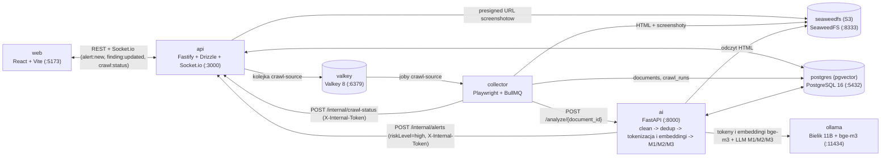

# InvestWatch — HackNation 2026 (UKNF)

System monitoringu treści o instrumentach i usługach finansowych w polskim internecie (100% open-source i on-premise: modele przez Ollamę, zero zewnętrznych API).

## Architektura i przepływ danych



### Etapy preprocessingu i analizy w serwisie `ai`
1. **Ekstrakcja i czyszczenie tekstu:** `trafilatura` usuwa szum HTML, pozostawiając czystą treść (`text_clean`).
2. **Deduplikacja:** dokładna (`content_hash` SHA-256) oraz przybliżona (64-bitowy `simhash` na 3-gramach słów, próg odległości Hamminga `6`).
3. **Tokenizacja i embeddingi:** tekst jest dzielony na tokeny do dopasowania fleksyjnego/leksykalnego (polskie końcówki, granice słów i anchory promocyjne dla 86 podmiotów KNF) oraz przekształcany przez model **`bge-m3`** w gęsty wektor semantyczny **`vector(1024)`** zapisywany w `pgvector`.
4. **Klasyfikacja M1 / M2 / M3 i walidacja cytatów:** hybrydowy scoring (`score = w_llm * llm + w_rules * rules + w_emb * emb`) z udziałem modelu **`SpeakLeash/bielik-11b-v2.3-instruct:Q4_K_M`** oraz weryfikacją dosłownych cytatów w tekście (`rapidfuzz.partial_ratio >= 90`).

### Uzasadnienie wyboru modeli: Bielik-11B + `bge-m3` (zamiast Gemma / klasycznego BERT)
- **`SpeakLeash/bielik-11b-v2.3-instruct:Q4_K_M` zamiast ogólnego modelu `Gemma`:**
  - **Natywny polski tokenizer i korpus:** Bielik (SpeakLeash / ACK Cyfronet AGH) został wytrenowany na szerokim polskim korpusie z dedykowanym polskim tokenizerem, dzięki czemu znacznie lepiej radzi sobie z polską fleksją, idiomami reklamowymi oraz terminologią finansowo-regulacyjną KNF/UKNF niż ogólne modele wielojęzyczne pokroju Gemmy.
  - **Precyzja cytowania i struktury JSON:** przy 11B parametrów (w kwantyzacji `Q4_K_M` mieszczącej się na pojedynczym GPU/CPU) stabilnie zwraca odpowiedzi zgodne ze schematem Pydantic (`format`, `temperature: 0`) i dosłowne cytaty z polskiego tekstu.
  - **Licencja Apache-2.0 i działanie 100% on-premise:** pełne prawo do komercyjnego i instytucjonalnego wdrożenia w infrastrukturze UKNF bez wysyłania wrażliwych materiałów nadzorczych do chmury.
- **`bge-m3` zamiast klasycznego `BERT`:**
  - Obsługuje długi kontekst (do 8192 tokenów wobec 512 w klasycznym BERT), daje 1024-wymiarowe wielojęzyczne embeddingi o wysokiej jakości dopasowania semantycznego dla polskich fraz doradczych (M3) i działa natywnie w tym samym silniku Ollama na licencji MIT.

## Wymagania sprzętowe

- **Docker:** silnik z Compose v2.
- **RAM:** minimum 16 GB (zalecane 32 GB przy jednoczesnym działaniu bazy, Playwrighta i modelu LLM).
- **GPU / CPU dla Ollama:**
  - Zalecane GPU NVIDIA >= 8 GB VRAM (uruchamiane opcjonalnym nadpisaniem `infra/docker-compose.gpu.yml`).
  - W trybie CPU inferencja LLM jest wolniejsza; reguły i dopasowanie embeddingów działają niezależnie.
- **Równoległość Ollamy i collectora:**
  - `OLLAMA_NUM_PARALLEL` w `.env` (domyślnie `1`). Przy `1` moduły jednego dokumentu czekają na siebie w Ollamie (ok. 82 s przy M1+M3); `2` pozwala liczyć je równolegle kosztem drugiego KV cache (więcej RAM/VRAM).
  - `ANALYZE_CONCURRENCY` w `.env` (domyślnie `1`, zalecane `1–2`) — ogranicza liczbę równoległych wywołań `/analyze` z `collector` do jednego lokalnego Bielika (`AI_ANALYZE_TIMEOUT_MS=600000` wobec budżetu AI `240 s`).
- **Zmierzone czasy na GPU (RTX 3060 12 GB, Bielik 11B Q4_K_M + `bge-m3`):** na ciepło ok. 3,4–5,8 s (M1/M3), 9–10,5 s (M2), < 0,15 s bez modułu; zimny start do ~30 s na GPU (na CPU > 60 s).
- **Dysk:** minimum **25 GB** wolnego miejsca (modele `SpeakLeash/bielik-11b-v2.3-instruct:Q4_K_M` i `bge-m3` to łącznie **~7–8 GB**, do tego obrazy Docker oraz przeglądarka Chromium dla Playwrighta).
- **Czas pierwszego uruchomienia (zimny start):** pierwsze uruchomienie pobiera obrazy oraz ~7–8 GB modeli Ollamy (`ollama-init`), a samo załadowanie Bielika 11B Q4 trwa **> 60 s**. Serwisy `ai` i `collector` czekają na zakończenie inicjalizacji (`s3-init`, `ollama-init`) — postęp sprawdzisz przez `docker compose logs -f ollama-init`.

## Quick Start

1. Skopiuj szablon środowiska (zawiera domyślne wartości dev do uruchomienia demo; poza demo zmień hasła i `INTERNAL_TOKEN`):

```bash
cp .env.example .env
```

2. Uruchom cały stos jedną komendą (pierwszy start z pobraniem ~7–8 GB modeli Ollamy i zimnym startem > 60 s potrwa kilka minut):

```bash
docker compose up --build -d
```

   Wariant z GPU NVIDIA:

```bash
docker compose -f docker-compose.yml -f infra/docker-compose.gpu.yml up --build -d
```

3. Sprawdź postęp i status kontenerów (dashboard dostępny pod `http://localhost:5173`):

```bash
docker compose logs -f ollama-init
docker compose ps
curl -s http://localhost:8000/health
curl -s http://localhost:3000/health
```

4. Po aktualizacji repo na **istniejącym wolumenie** Postgresa pliki `infra/db/*.sql` nie uruchomią się ponownie (działają tylko na pustym wolumenie). Zastosuj nowe migracje ręcznie (są idempotentne), np.:

```bash
docker compose exec -T postgres sh -c 'psql -U "${POSTGRES_USER:-investwatch}" -d "${POSTGRES_DB:-investwatch}"' < infra/db/004_seen_tracking.sql
```

   Objaw braku migracji: `GET /findings` zwraca 500 (`column ... does not exist`). Nie używaj `docker compose down -v`: kasuje też wolumen `ollama_data` (kilka GB modeli) i bazę.

## Serwisy i porty

`postgres`, `valkey`, `seaweedfs`, `ollama` i `ai` są dostępne tylko z hosta (`127.0.0.1`); z sieci zewnętrznej widoczne są wyłącznie `web` (5173) i `api` (3000).


| Serwis | Technologia | Port | Rola |
|---|---|---|---|
| `web` | React + Vite + TS (Nginx) | `5173` | Dashboard analityka UKNF, filtry, trendy, kalibracja, toasty alertów |
| `api` | Node 22 + Fastify + Drizzle + Socket.io | `3000` | REST API, agregator wyników M1/M2/M3 (`GET /documents`), śledzenie widoczności M1 (`first_seen_at`/`last_seen_at`/`isActive`), eksport, `X-Internal-Token`, eventy real-time |
| `ai` | Python 3.12 + FastAPI | `127.0.0.1:8000` | Czyszczenie tekstu, dedup, tokenizacja i embeddingi `bge-m3`, moduły M1/M2/M3, `/eval` |
| `collector` | Node 22 + TypeScript + Playwright + BullMQ | — | Harmonogram i wykonywanie crawli, zapis HTML/screenshotów do S3 |
| `postgres` | `pgvector/pgvector:0.8.7-pg16` | `127.0.0.1:5432` | Dane relacyjne i wektory `vector(1024)` (init z `infra/db/`) |
| `valkey` | `valkey/valkey:8.1.12-alpine` | `127.0.0.1:6379` | Broker kolejek BullMQ (`crawl-source`) |
| `seaweedfs` | `chrislusf/seaweedfs:4.52` | `127.0.0.1:8333` | Object storage kompatybilny z S3, z kluczami (bucket inicjowany przez `s3-init`) |
| `ollama` | `ollama/ollama:0.40.17` | `127.0.0.1:11434` | Lokalna inferencja LLM i embeddingów (modele pobiera `ollama-init`) |

## API (`api/`, port 3000)

REST dla dashboardu i Socket.io dla alertów. Pełne kształty JSON, parametry i kody błędów: [docs/contracts.md](docs/contracts.md#api-api-port-3000).

| Metoda | Ścieżka | Opis |
|---|---|---|
| GET | `/health` | stan serwisu |
| GET | `/findings` | lista findingów; filtry `module, risk, status, source, from, to, q`, paginacja `page, pageSize` |
| GET | `/findings/:id` | finding + dokument, cytaty (`reasons`), screenshot (presigned URL, 15 min), historia statusów |
| PATCH | `/findings/:id/status` | `new → in_review → confirmed \| dismissed`, zapis historii, emit `finding:updated` |
| GET | `/documents`, `/documents/:id` | agregator: jeden obiekt na dokument z wynikami M1/M2/M3 i podsumowaniem `overall` |
| GET | `/stats/trend` | liczba findingów w czasie (`bucket=day\|hour`, opcjonalnie `module`) |
| GET | `/stats/summary` | liczniki per moduł, ryzyko, źródło, status |
| GET / PUT | `/settings/modules/:module` | próg i wagi scoringu modułu (0–1, suma wag = 1) |
| GET | `/eval?module=&threshold=` | proxy do `ai /eval`: precision, recall, TP/FP/FN/TN |
| GET | `/sources` | źródła + ostatni przebieg crawla |
| POST | `/sources/:id/run` | ręczny crawl (job w kolejce `crawl-source`), `202` |
| GET | `/export?format=csv\|json` | raport M1/M2/M3 z tymi samymi filtrami co `/findings`; CSV z BOM, separator `;` |
| POST | `/internal/alerts` | tylko z `ai`, nagłówek `X-Internal-Token` → emit `alert:new` |
| POST | `/internal/crawl-status` | tylko z `collector`, nagłówek `X-Internal-Token` → emit `crawl:status` |

**Socket.io** (CORS tylko `WEB_ORIGIN`):

| Zdarzenie | Kiedy |
|---|---|
| `alert:new` | ai zapisało finding z ryzykiem `high` |
| `finding:updated` | zmiana statusu przez `PATCH /findings/:id/status` |
| `crawl:status` | collector zaczął lub skończył crawl źródła |

**Bezpieczeństwo:** każde wejście walidowane przez `zod`, błędy jako `{ error, message }` bez stack trace'ów, rate limit 300/min na IP (`/export` 10/min), CORS tylko dla `WEB_ORIGIN`. `/internal/*` wymaga `X-Internal-Token` (`INTERNAL_TOKEN`). Opcjonalny `ADMIN_TOKEN` (min. 16 znaków) zamyka zapisy (`PUT`/`PATCH`/`POST` poza `/internal/*`) za `Authorization: Bearer`. Szczegóły i wynik `npm audit`: [api/SECURITY.md](api/SECURITY.md).

## Konfiguracja i dokumentacja

Wszystkie zmienne środowiskowe oraz ich opisy znajdują się w [.env.example](.env.example). Sekrety są przekazywane do kontenerów wyłącznie przez `env_file: [.env]` — pliku `.env` nie wolno commitować do repozytorium.
Najważniejsze zmienne: `OLLAMA_LLM_MODEL`, `OLLAMA_EMBED_MODEL`, `OLLAMA_NUM_PARALLEL`, `ANALYZE_CONCURRENCY`, `AI_REQUIRE_TOKEN`, `S3_PUBLIC_ENDPOINT` (adres S3 widziany z przeglądarki), `WEB_ORIGIN`, `VITE_API_URL`.

**Tokeny (opcjonalne).** `ADMIN_TOKEN` (api) razem z `VITE_ADMIN_TOKEN` (web) włączają wymóg `Authorization: Bearer` dla zapisów REST (PUT/PATCH/POST); oba muszą mieć tę samą wartość (min. 16 znaków), a po zmianie `VITE_ADMIN_TOKEN` trzeba przebudować `web`: `docker compose up -d --build web`. `AI_REQUIRE_TOKEN=true` wymusza nagłówek `X-Internal-Token` w serwisie `ai`; włączaj dopiero, gdy collector go wysyła. `AI_CONFIG` pozwala wskazać inny `config.yaml` dla `ai`.

**CI.** Workflow GitHub Actions (`infra/ci/ci.yml`, docelowo `.github/workflows/ci.yml`) na PR do `main` buduje i testuje `api`, `collector`, `web`, uruchamia `ruff` i `pytest` w `ai`, audyty `npm audit` i `pip-audit` oraz `docker compose config -q`.

- Kontrakt schematu DB i API: [docs/contracts.md](docs/contracts.md)
- Bezpieczeństwo i skany obrazów/paczek: [docs/SECURITY.md](docs/SECURITY.md)
- Wykaz bibliotek, narzędzi i licencji: [docs/DEPENDENCIES.md](docs/DEPENDENCIES.md)
- Standaryzowany proces pracy z AI: [docs/AI_PROCESS.md](docs/AI_PROCESS.md)
- Prezentacja PDF i opis zgłoszeniowy: [presentation/InvestWatch.pdf](presentation/InvestWatch.pdf), [presentation/PROJECT_DESCRIPTION.md](presentation/PROJECT_DESCRIPTION.md)
