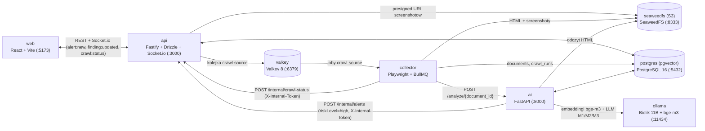

# InvestWatch — HackNation 2026 (UKNF)

System monitoringu treści o instrumentach i usługach finansowych w polskim internecie (100% open-source i on-premise: modele przez Ollamę, zero zewnętrznych API).

## Architektura i przepływ danych



## Wymagania sprzętowe

- **Docker:** silnik z Compose v2.
- **RAM:** minimum 16 GB (zalecane 32 GB przy jednoczesnym działaniu bazy, Playwrighta i modelu LLM).
- **GPU / CPU dla Ollama:**
  - Zalecane GPU NVIDIA >= 8 GB VRAM (uruchamiane opcjonalnym nadpisaniem `infra/docker-compose.gpu.yml`).
  - W trybie CPU inferencja LLM jest wolniejsza; reguły i dopasowanie embeddingów działają niezależnie.
- **Dysk:** minimum **25 GB** wolnego miejsca (modele `SpeakLeash/bielik-11b-v2.3-instruct:Q4_K_M` i `bge-m3` to łącznie **~7–8 GB**, do tego obrazy Docker oraz przeglądarka Chromium dla Playwrighta).
- **Czas pierwszego uruchomienia (zimny start):** pierwsze uruchomienie pobiera obrazy oraz ~7–8 GB modeli Ollamy (`ollama-init`), a samo załadowanie Bielika 11B Q4 trwa **> 60 s**. Serwisy `ai` i `collector` czekają na zakończenie inicjalizacji (`s3-init`, `ollama-init`) — postęp sprawdzisz przez `docker compose logs -f ollama-init`.

## Quick Start

1. Skopiuj szablon środowiska (zawiera domyślne wartości dev do uruchomienia demo; poza demo zmień hasła i `INTERNAL_TOKEN`):

```bash
cp .env.example .env
```

2. Uruchom cały stos jedną komendą (pierwszy start z pobraniem ~7–8 GB modeli Ollamy i zimnym startem > 60 s potrwa kilka minut):

```bash
docker compose up --build -d
```

   Wariant z GPU NVIDIA:

```bash
docker compose -f docker-compose.yml -f infra/docker-compose.gpu.yml up --build -d
```

3. Sprawdź postęp i status kontenerów (dashboard dostępny pod `http://localhost:5173`):

```bash
docker compose logs -f ollama-init
docker compose ps
curl -s http://localhost:8000/health
curl -s http://localhost:3000/health
```

## Serwisy i porty

| Serwis | Technologia | Port | Rola |
|---|---|---|---|
| `web` | React + Vite + TS (Nginx) | `5173` | Dashboard analityka UKNF, filtry, trendy, kalibracja, toasty alertów |
| `api` | Node 22 + Fastify + Drizzle + Socket.io | `3000` | REST API, eksport, `X-Internal-Token`, eventy real-time |
| `ai` | Python 3.12 + FastAPI | `8000` | Czyszczenie tekstu, dedup (hash + simhash), `bge-m3`, moduły M1/M2/M3, `/eval` |
| `collector` | Node 22 + TypeScript + Playwright + BullMQ | — | Harmonogram i wykonywanie crawli, zapis HTML/screenshotów do S3 |
| `postgres` | `pgvector/pgvector:0.8.7-pg16` | `5432` | Dane relacyjne i wektory `vector(1024)` (init z `infra/db/`) |
| `valkey` | `valkey/valkey:8.1.12-alpine` | `6379` | Broker kolejek BullMQ (`crawl-source`) |
| `seaweedfs` | `chrislusf/seaweedfs:3.96` | `8333` | Object storage kompatybilny z S3 (bucket inicjowany przez `s3-init`) |
| `ollama` | `ollama/ollama:0.40.17` | `11434` | Lokalna inferencja LLM i embeddingów (modele pobiera `ollama-init`) |

## Konfiguracja

Wszystkie zmienne środowiskowe oraz ich opisy znajdują się w [.env.example](.env.example). Sekrety są przekazywane do kontenerów wyłącznie przez `env_file: [.env]` — pliku `.env` nie wolno commitować do repozytorium.
Najważniejsze zmienne: `OLLAMA_LLM_MODEL`, `OLLAMA_EMBED_MODEL`, `S3_PUBLIC_ENDPOINT` (adres S3 widziany z przeglądarki), `WEB_ORIGIN`, `VITE_API_URL`.

Kontrakt schematu bazy danych i endpointów znajduje się w [docs/contracts.md](docs/contracts.md), raport bezpieczeństwa i audytu zależności w [docs/SECURITY.md](docs/SECURITY.md), a lista zależności i licencji w [docs/DEPENDENCIES.md](docs/DEPENDENCIES.md).
