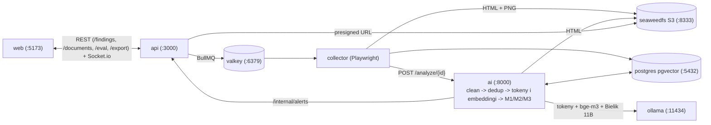

<!-- Slajd 1 -->
# InvestWatch
### Automatyczny monitoring treści inwestycyjnych w polskim internecie

**Zadanie UKNF · HackNation 2026 · 100% open-source i on-premise**

- **Problem:** szybki przyrost reklam inwestycyjnych w sieci i social mediach (finfluencerzy, brak lub ukrycie ostrzeżeń o ryzyku, nielegalne doradztwo poza rejestrem KNF).
- **Wyzwanie nadzoru:** ręczny przegląd setek stron i postów jest wolny, a materiały reklamowe szybko znikają.
- **Rozwiązanie:** system wykrywający naruszenia w 3 modułach (M1/M2/M3) z gotowym dowodem: **dosłownym cytatem, oceną kryteriów i screenshotem z S3**.

---

<!-- Slajd 2 -->
## Architektura systemu (100% on-premise)

> Źródło diagramu: `presentation/architecture.mmd` (osadzony jako wektorowy SVG w `InvestWatch.pdf`)

- **Stos:** Node 22 (TS strict: `collector`, `api`), Python 3.12 (`ai` FastAPI), React 19 + Vite (`web`), PostgreSQL 16 + `pgvector` + `pg_trgm`, Valkey 8, SeaweedFS S3, Ollama.
- **Uruchomienie jedną komendą:** `cp .env.example .env && docker compose up --build` (wszystkie obrazy z przypiętymi wersjami).

---

<!-- Slajd 3 -->
## Moduł 1/3: `collector` i `api` — zbieranie danych i agregacja wyników

- **`collector` (Node 22 + Playwright + BullMQ):**
  - **Zakres źródeł (MVP):** aktywne adaptery `sample` (dane offline), `web` (Chromium, discovery z głębokości 1, rotacja 23 User-Agentów i `PROXY_LIST`, limit 2/host, jitter) oraz `youtube` (publiczny RSS kanałów) + harmonogram `sources.cron`. Adaptery FB/IG/TikTok pozostają poza obecnym MVP (gotowy interfejs adaptera; w UI filtr źródeł dynamicznie ukrywa nieaktywne typy z `GET /sources`).
  - Zapisuje HTML i screenshot PNG do SeaweedFS S3 oraz metadane do `documents` (`upsert` po `url_hash`, triggery `first_seen_at` / `last_seen_at`).
- **`api` (Fastify + Drizzle + Socket.io):**
  - **Agregator M1/M2/M3 (`GET /documents`, `GET /documents/:id`):** składa wyniki modułów w jeden rekord dokumentu (`modules` `"1"/"2"/"3"` + podsumowanie `overall`: `maxScore`, `riskLevel`, `flaggedModules`).
  - **Śledzenie widoczności reklam M1:** `first_seen_at`, `last_seen_at` oraz wyliczane `isActive` (karencja 1 h po późniejszym pełnym przebiegu `ok`).
  - REST API + Socket.io (`alert:new`, `finding:updated`, `crawl:status`), indeksy GIN `pg_trgm`, presigned URL (15 min) i eksport CSV/JSON.

---

<!-- Slajd 4 -->
## Moduł 2/3: `ai` — tokenizacja, embeddingi oraz M1/M2/M3

- **Preprocessing:** ekstrakcja tekstu (`trafilatura`) → deduplikacja dokładna (SHA-256) i przybliżona (`simhash` na 3-gramach słów, próg Hamminga `6`) → **tokenizacja i embeddingi** (tokenizacja leksykalno-fleksyjna z granicami słów dla aliasów KNF + wektory `bge-m3` `vector(1024)` w `pgvector`).
- **3 moduły analityczne:**
  1. **M1 (Finfluencerzy):** wzmianka o firmie z rejestru KNF (86 podmiotów w `entities.csv`) spoza jej `official_domains` / `social_handles`.
  2. **M2 (Informacja o ryzyku):** ewolucja `m2-v1` (4 kryteria) → `m2-v3` (8 kryteriów na `main` wg MiFID II art. 44 / rozporządzenia 2017/565) → `m2-v4` (`team/ai-core`: **16 kryteriów tekstowych** zmapowanych na reguły tekstowe 1, 2, 3, 6, 9–12b, 14–18 załącznika UKNF; 5 reguł układu graficznego 4, 5, 7, 8, 13 wymaga HTML/screenshotu i jest poza zakresem tekstowym).
  3. **M3 (Shadow advisory):** nielicencjonowane doradztwo i zarządzanie portfelem wg **art. 76** ustawy o obrocie instrumentami finansowymi (`rules/m3.yaml` + embeddingi `bge-m3` + ocena LLM).
- **Dlaczego `Bielik-11B-v2.3-Instruct` i `bge-m3` zamiast `Gemma` / `BERT`?**
  - **Bielik 11B (Apache-2.0):** natywny polski tokenizer i korpus → precyzyjna polska fleksja, terminologia UKNF i strukturalny JSON. Pomiar na GPU RTX 3060 12 GB: **3,4–5,8 s** (M1/M3), **9–10,5 s** (M2), **< 0,15 s** bez modułu.
  - **`bge-m3` (MIT):** okno 8192 tokenów (16× więcej niż klasyczny BERT) i wielojęzyczne wektory 1024-dim w tej samej Ollamie.

---

<!-- Slajd 5 -->
## Moduł 3/3: `web` — dashboard analityka UKNF

- **Widoki robocze (React 19 + Vite + Tailwind + Recharts, styl instytucjonalny `knf.gov.pl`):**
  - **Findingi:** tabela incydentów z filtrami (moduł, ryzyko, status, dynamiczne źródło z `GET /sources`, zakres dat, wyszukiwarka pełnotekstowa `q` z debounce 300 ms) oraz paginacją.
  - **Szczegóły findingu:** pełna treść po czyszczeniu, lista `reasons[]` z polskimi etykietami, **dosłownym cytatem** i werdyktem, podgląd screenshota z S3, zmiana statusu z historią audytu.
  - **Trendy i raportowanie:** kafelki podsumowania (`/stats/summary`), wykres incydentów w czasie (`/stats/trend`), eksport CSV/JSON dla polskiego Excela (`;`, przecinek dziesiętny, BOM UTF-8, neutralizacja formula injection `= + - @`).
  - **Kalibracja, alerty i źródła:** toasty `alert:new` przez Socket.io, licznik **„Oznaczone flagą”** (`tp + fp`), zapis progu i wag oraz przycisk **„Uruchom crawl”**.
- **Lekki i bezpieczny obraz produkcyjny:** code-splitting (`React.lazy`, główny chunk 346 kB) serwowany przez **`nginx:1.30.7-alpine` + `apk upgrade libxml2`** (**Trivy: 0 CRITICAL / 0 HIGH**).

---

<!-- Slajd 6 -->
## Kalibracja, wiarygodność i odporność na prompt injection

- **Hybrydowy scoring:**
  `score = w_llm * llm + w_rules * rules + w_emb * emb` (domyślnie `0.60 / 0.25 / 0.15`, edytowalne w `module_settings`).
- **Zasada „bez cytatu nie ma flagi” i walidacja wielozdaniowa:**
  - `CriterionResult.quote` jest wymagane w schemacie JSON (Pydantic `format`, `temperature: 0`).
  - `quotes.py` weryfikuje dopasowanie cytatu do dokumentu (`rapidfuzz.partial_ratio >= 90`; dla cytatu wielozdaniowego każde zdanie osobno). Przy awarii LLM dokument otrzymuje `failed` — zero zmyślonych wyników.
- **Odporność na prompt injection (`ai/tests/test_prompt_injection.py`):**
  - Treść strony izolowana w `<document>...</document>` (`neutralize_delimiters` w `llm.py`): **12 testów offline + 3/3 testy live na Bieliku 11B** (wyniki z atakiem identyczne z bazowymi: M1 `0.941`, M2 `1.000`, M3 `0.956`, zero cytatów z payloadu ataku).
- **Progi i panel kalibracji (`GET /eval` + `gold.csv` + `rubric.md`):**
  - `high >= 0.8` (alert Socket.io), `medium >= próg`, `low < próg`; suwak progu na żywo przelicza `precision`, `recall`, `TP`, `FP`, `FN`, `TN` na ręcznie oznaczonym zbiorze wg rubryki UKNF.

---

<!-- Slajd 7 -->
## Bezpieczeństwo i czystość licencyjna

- **Izolacja sieci i kontenerów:** wszystkie usługi w dedykowanej sieci bridge Docker Compose; kontenery `api` (`USER node`), `collector` (`USER pwuser`) i `ai` (`USER app`) działają bez uprawnień roota; przypięte wersje obrazów (zero `latest`).
- **Sekrety i walidacja startowa:** sekrety wyłącznie w `.env` (`.gitignore`), wstrzykiwane przez `env_file`; `api/src/config.ts` i `collector/src/config.ts` walidują zmienne przez `zod` przy starcie (`INTERNAL_TOKEN` >= 16 znaków).
- **Ochrona ruchu wewnętrznego i logów:** `/internal/*` chronione `X-Internal-Token` (`timingSafeEqual` na SHA-256), opcjonalna straż endpointów AI (`AI_REQUIRE_TOKEN`, `hmac.compare_digest`), CORS ograniczony do `WEB_ORIGIN`, maskowanie pól wrażliwych (`redact`) w `pino`, rate-limit `300/min` (`10/min` na `/export`).
- **100% lokalne AI i czyste licencje (`docs/SECURITY.md`, `docs/DEPENDENCIES.md`):** Valkey (BSD-3), SeaweedFS (Apache-2.0), `asyncpg` (Apache-2.0), Bielik (Apache-2.0), `bge-m3` (MIT).
- **Wyniki audytów:** `npm audit` ×3 i `pip-audit` (`47` paczek runtime / `50` z dev + OSV `55` paczek) = **0 podatności**; obraz produkcyjny `web` w Trivy = **0 CRITICAL / 0 HIGH**; pozostałe obrazy zeskanowane `docker scout quickview`.

---

<!-- Slajd 8 -->
## Standaryzowany proces pracy z AI (20% oceny — `docs/AI_PROCESS.md`)

- **Kontrakt w `CLAUDE.md` + 5 skilli (`.claude/skills/`):** obowiązek *plan-first* (najpierw plan i akceptacja człowieka, potem kod), zakaz `console.log`/`print`, skille `scraper-adapter`, `risk-classifier`, `data-contract`, `dependency-guard`, `demo-check`.
- **Ochrona w Gicie (`.githooks/pre-commit`):** twardy podział katalogów na 6 branchy `team/*`, blokada commitów na `main` oraz automatyczna blokada sekretów w diffie.
- **Przykłady z `docs/AI_PROCESS.md`, gdzie weryfikacja człowiek + AI wyłapała błędy:**
  - `ai-core`: `dependency-guard` odrzucił `psycopg` (LGPL-3.0) → `asyncpg` (Apache-2.0); testy na żywym Bieliku wykryły kopiowanie cytatu i sklejanie zdań → `m2-v2`/`m3-v2` oraz walidacja per zdanie w `quotes.py`.
  - `ai-data` + `api`: testy na `pgvector` podniosły próg `simhash` `3 → 6`; w `api` złapano błąd `date_trunc`, kolizję `"id"` w `/sources` oraz brak kwalifikacji tabeli w `seen.ts`.
  - `web` + `lead-collector` + `infra`: test na żywym API naprawił zapis progu kalibracji (`weights`), skan Trivy wykrył i załatał `libxml2` w `web` (`0C/0H`), a w `collector`/`infra` naprawiono `ioredis`, `pull-models.sh` i healthcheck `web`.

---

<!-- Slajd 9 -->
## Demo na żywo — kluczowy przepływ

1. **Start stosu:** `docker compose up --build` → czyste środowisko z gotowym buckietem S3, bazą `pgvector` i modelami w Ollamie.
2. **Wyzwolenie crawla:** ekran **Źródła** → **„Uruchom crawl”** → status `crawl:status` na żywo.
3. **Alert wysokiego ryzyka:** toast **`alert:new`** w przeglądarce bez odświeżania strony.
4. **Analiza dowodów:** wejście w szczegóły findingu (oraz agregator `/documents`) → cytaty per kryterium + screenshot z SeaweedFS S3 + ocena modułów M1/M2/M3.
5. **Kalibracja i raport:** suwak progu zmienia `precision` / `recall` / `FP` / `FN` i licznik „Oznaczone flagą”, zmiana statusu na `confirmed` i eksport CSV.

*(Pełny scenariusz z podziałem na sekundy: `presentation/DEMO_SCRIPT.md`.)*

---

<!-- Slajd 10 -->
## Dalszy rozwój i skalowanie

- **Analiza 5 reguł układu graficznego M2 (reguły UKNF 4, 5, 7, 8, 13):** weryfikacja rozmiaru czcionki, kontrastu, dostępu jednym kliknięciem, responsywności oraz dominacji wyników historycznych na wyrenderowanym DOM i screenshotach S3 (VLM / Playwright CSS metrics).
- **Adaptery social mediów i rozbudowa rejestru KNF (`entities.csv`):** wdrożenie kolektorów Facebook/Instagram/TikTok (interfejs `Adapter` gotowy w `collector/`) oraz uzupełnienie `official_domains` i `social_handles` dla wszystkich podmiotów KNF.
- **Analiza wideo (OCR / ASR) i tryb produkcyjny:** transkrypcja rolek (YouTube Shorts, TikTok, Reels), wymuszenie `-s3.config` w SeaweedFS oraz `AI_REQUIRE_TOKEN=1` po dopięciu nagłówka `X-Internal-Token` w `collector/`.
- **Ciągłe strojenie jakości:** rozbudowa zbioru `gold.csv` wg `ai/eval/rubric.md`, wdrożenie `m2-v4` (16 kryteriów) na pełnym stosie oraz skalowanie `OLLAMA_NUM_PARALLEL > 1` na wielu GPU.
