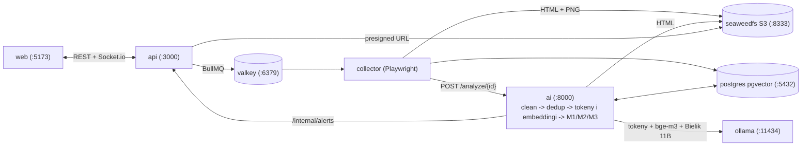

<!-- Slajd 1 -->
# InvestWatch
### Automatyczny monitoring treści inwestycyjnych w polskim internecie

**Zadanie UKNF · HackNation 2026 · 100% open-source i on-premise**

- **Problem:** szybki przyrost reklam inwestycyjnych w sieci i social mediach (finfluencerzy, brak lub ukrycie ostrzeżeń o ryzyku, nielegalne doradztwo poza rejestrem KNF).
- **Wyzwanie nadzoru:** ręczny przegląd setek stron i postów jest wolny, a materiały reklamowe szybko znikają.
- **Rozwiązanie:** system wykrywający naruszenia w 3 modułach (M1/M2/M3) z gotowym dowodem: **dosłownym cytatem, oceną kryteriów i screenshotem z S3**.

---

<!-- Slajd 2 -->
## Architektura systemu (100% on-premise)

> Źródło diagramu: `presentation/architecture.mmd` (do eksportu jako PNG/SVG na slajd)

- **Stos:** Node 22 (TS strict: `collector`, `api`), Python 3.12 (`ai` FastAPI), React 19 + Vite (`web`), PostgreSQL 16 + `pgvector` + `pg_trgm`, Valkey 8, SeaweedFS S3, Ollama.
- **Uruchomienie jedną komendą:** `cp .env.example .env && docker compose up --build` (wszystkie obrazy z przypiętymi wersjami).

---

<!-- Slajd 3 -->
## Moduł 1/3: `collector` i `api` — zbieranie danych i dystrybucja zdarzeń

- **`collector` (Node 22 + Playwright + BullMQ):**
  - Adaptery: `sample` (dane offline), `web` (Chromium, discovery linków z głębokości 1, rotacja 23 User-Agentów i `PROXY_LIST`, limit 2/host, jitter) oraz `youtube` (publiczny RSS kanałów finfluencerów i domów maklerskich) + harmonogram `sources.cron`.
  - Zapisuje surowy HTML i screenshot PNG do SeaweedFS S3 oraz metadane do `documents` (`upsert` po `url_hash`), raportuje `POST /internal/crawl-status` i wywołuje `POST /analyze/{document_id}`.
- **`api` (Fastify + Drizzle + Socket.io):**
  - REST API: `GET /findings` (filtry + indeksy GIN `pg_trgm`), `GET /findings/:id` (cytaty + presigned `screenshotUrl` ważny 15 min), `PATCH /findings/:id/status` (`SELECT ... FOR UPDATE` + historia), `/stats/trend`, `/stats/summary`, `/settings/modules/:module`, `/eval`, `/sources`, `/export` (CSV/JSON).
  - Socket.io real-time: `alert:new`, `finding:updated`, `crawl:status`.

---

<!-- Slajd 4 -->
## Moduł 2/3: `ai` — preprocessing (tokenizacja i embeddingi) oraz M1/M2/M3

- **Preprocessing:** ekstrakcja tekstu (`trafilatura`) → deduplikacja dokładna (SHA-256) i przybliżona (`simhash` na 3-gramach słów, próg Hamminga `6`) → **tokenizacja i embeddingi** (tokenizacja leksykalno-fleksyjna z granicami słów dla aliasów KNF + wektory `bge-m3` `vector(1024)` w `pgvector`).
- **3 moduły analityczne:**
  1. **M1 (Finfluencerzy):** wzmianka o firmie z rejestru KNF (86 podmiotów w `entities.csv`) publikowana spoza jej `official_domains` / `social_handles`.
  2. **M2 (Informacja o ryzyku):** ocena materiałów firm inwestycyjnych wg 4 kryteriów z `ai/prompts/m2-risk-info/system.md` (`risk_warning_present`, `risk_prominence`, `profit_risk_balance`, `no_guaranteed_returns`).
  3. **M3 (Shadow advisory):** nielicencjonowane doradztwo i zarządzanie portfelem (`rules/m3.yaml` + podobieństwo embeddingów `bge-m3` do fraz wzorcowych + ocena LLM).
- **Dlaczego `Bielik-11B-v2.3-Instruct` i `bge-m3` zamiast `Gemma` / klasycznego `BERT`?**
  - **Bielik 11B (SpeakLeash, Apache-2.0):** natywny polski tokenizer i korpus → lepsze rozumienie polskiej fleksji i żargonu regulacyjnego KNF niż w wielojęzycznej Gemmie, przy zachowaniu precyzyjnego JSON-a i dosłownych cytatów.
  - **`bge-m3` (MIT):** kontekst do 8192 tokenów (wobec 512 w klasycznym BERT) i wielojęzyczne wektory 1024-dim w tym samym silniku Ollama.

---

<!-- Slajd 5 -->
## Moduł 3/3: `web` — dashboard analityka UKNF

- **Widoki robocze (React 19 + Vite + Tailwind + Recharts, styl instytucjonalny `knf.gov.pl`):**
  - **Findingi:** tabela incydentów z filtrami (moduł, ryzyko, status, źródło, zakres dat, wyszukiwarka pełnotekstowa `q`) oraz paginacją.
  - **Szczegóły findingu:** pełna treść po czyszczeniu, lista `reasons[]` z **dosłownym cytatem** i werdyktem, podgląd screenshota z S3, zmiana statusu z historią audytu.
  - **Trendy i raportowanie:** kafelki podsumowania (`/stats/summary`), wykres incydentów w czasie (`/stats/trend`), eksport CSV/JSON dostosowany do polskiego Excela (`;`, przecinek dziesiętny, BOM UTF-8, neutralizacja formula injection `= + - @`).
  - **Alerty i źródła:** toasty `alert:new` na żywo przez Socket.io oraz przycisk **„Uruchom crawl”** na liście źródeł.
- **Lekki obraz produkcyjny:** code-splitting (`React.lazy`, główny chunk 346 kB) serwowany przez `nginx:1.27.5-alpine`.

---

<!-- Slajd 6 -->
## Kalibracja i wiarygodność wyników

- **Hybrydowy scoring:**
  `score = w_llm * llm + w_rules * rules + w_emb * emb` (domyślnie `0.60 / 0.25 / 0.15`, edytowalne w `module_settings`).
- **Zasada „bez cytatu nie ma flagi”:**
  - `CriterionResult.quote` jest wymagane w schemacie JSON (Pydantic `format`, `temperature: 0`).
  - Walidacja dopasowania cytatu do treści dokumentu (`rapidfuzz.partial_ratio >= 90`); przy awarii LLM serwis oznacza dokument jako `failed` — nigdy nie wymyśla wyniku.
- **Progi i panel kalibracji na żywo (`GET /eval` + `gold.csv`):**
  - `high >= 0.8` (alert Socket.io), `medium >= próg`, `low < próg`.
  - Suwak progu w dashboardzie na bieżąco przelicza **`precision`, `recall`, `TP`, `FP`, `FN`, `TN`** i pozwala zapisać próg przez `PUT /settings/modules/:module`.

---

<!-- Slajd 7 -->
## Bezpieczeństwo i czystość licencyjna

- **Izolacja sieci i kontenerów:** wszystkie usługi w dedykowanej sieci bridge Docker Compose; kontenery `api` (`USER node`), `collector` (`USER pwuser`) i `ai` (`USER app`) działają bez uprawnień roota; przypięte wersje obrazów (zero `latest`).
- **Sekrety i walidacja startowa:** sekrety wyłącznie w `.env` (`.gitignore`), wstrzykiwane przez `env_file`; `api/src/config.ts` i `collector/src/config.ts` walidują zmienne przez `zod` przy starcie (`INTERNAL_TOKEN` >= 16 znaków).
- **Ochrona ruchu wewnętrznego i logów:** `/internal/*` chronione `X-Internal-Token` (`timingSafeEqual` na SHA-256), CORS ograniczony do `WEB_ORIGIN`, maskowanie pól wrażliwych (`redact`) w `pino`, rate-limit `300/min` (i `10/min` na `/export`).
- **100% lokalne AI i odporność na prompt injection:** dane analizowane wyłącznie w lokalnej Ollamie, treść stron izolowana w `<document>...</document>`.
- **Czyste licencje i audyt (`docs/SECURITY.md`, `docs/DEPENDENCIES.md`):** Valkey (BSD-3), SeaweedFS (Apache-2.0), `asyncpg` (Apache-2.0); `pip-audit` i `npm audit` = **0 podatności w paczkach aplikacji** + wykonany skan obrazów `docker scout quickview`.

---

<!-- Slajd 8 -->
## Standaryzowany proces pracy z AI (20% oceny — `docs/AI_PROCESS.md`)

- **Kontrakt w `CLAUDE.md` + 5 skilli (`.claude/skills/`):** obowiązek *plan-first* (najpierw plan i akceptacja człowieka, potem kod), zakaz `console.log`/`print`, skille `scraper-adapter`, `risk-classifier`, `data-contract`, `dependency-guard`, `demo-check`.
- **Ochrona w Gicie (`.githooks/pre-commit`):** twardy podział katalogów na 6 branchy `team/*`, blokada commitów na `main` oraz automatyczna blokada sekretów w diffie.
- **Przykłady z `docs/AI_PROCESS.md`, gdzie weryfikacja człowiek + AI wyłapała błędy:**
  - `ai-core`: `dependency-guard` wykrył licencję LGPL-3.0 dla `psycopg` → zamieniono na `asyncpg` (Apache-2.0); test na Bieliku wykrył kopiowanie jednego cytatu → bump promptu do `m2-v2`.
  - `ai-data`: testy integracyjne na `pgvector` wykazały, że próg `simhash = 3` przepuszcza near-duplikaty → podniesiono do `6`.
  - `api`: testy na Postgresie złapały błąd `date_trunc` w `/stats/trend` oraz kolizję `"id"` w podzapytaniu Drizzle dla `/sources`.
  - `lead-collector` i `infra`: dodano brakujący `ioredis` dla `bullmq`, semafor współbieżności analiz LLM, obsługę błędów JSON w `pull-models.sh` oraz wymuszenie LF w `.gitattributes`.

---

<!-- Slajd 9 -->
## Demo na żywo — kluczowy przepływ

1. **Start stosu:** `docker compose up --build` → czyste środowisko z gotowym buckietem S3, bazą `pgvector` i modelami w Ollamie.
2. **Wyzwolenie crawla:** ekran **Źródła** → **„Uruchom crawl”** → status `crawl:status` na żywo.
3. **Alert wysokiego ryzyka:** toast **`alert:new`** w przeglądarce bez odświeżania strony.
4. **Analiza dowodów:** wejście w szczegóły findingu → cytaty per kryterium + screenshot z SeaweedFS S3 + ocena modułów M1/M2/M3.
5. **Kalibracja i raport:** suwak progu zmienia `precision` / `recall` / `FP` / `FN`, zmiana statusu na `confirmed` i eksport CSV.

*(Pełny scenariusz z podziałem na sekundy: `presentation/DEMO_SCRIPT.md`.)*

---

<!-- Slajd 10 -->
## Dalszy rozwój i skalowanie

- **Rozbudowa rejestru KNF (`entities.csv`):** uzupełnienie pełnych `official_domains` i `social_handles` dla wszystkich podmiotów nadzorowanych (redukcja fałszywych alertów w M1).
- **Analiza treści wideo i grafik (OCR / ASR):** automatyczna transkrypcja rolek (TikTok, YouTube Shorts, Instagram Reels) oraz ekstrakcja drobnego druku ze zdjęć reklam.
- **Bezpieczeństwo produkcyjne i skalowanie:** wymuszenie autoryzacji `-s3.config` w SeaweedFS, aktualizacja bazowych obrazów Alpine/Debian oraz rozproszona pula workerów `collector` (`OLLAMA_NUM_PARALLEL > 1` na wielu GPU).
- **Ciągłe strojenie jakości:** rozbudowa zbioru `gold.csv` przez analityków UKNF i okresowa re-ewaluacja wag oraz wersji promptów przez `/reanalyze`.
