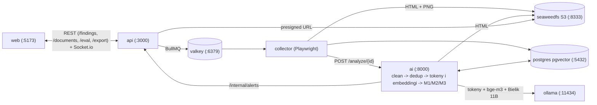
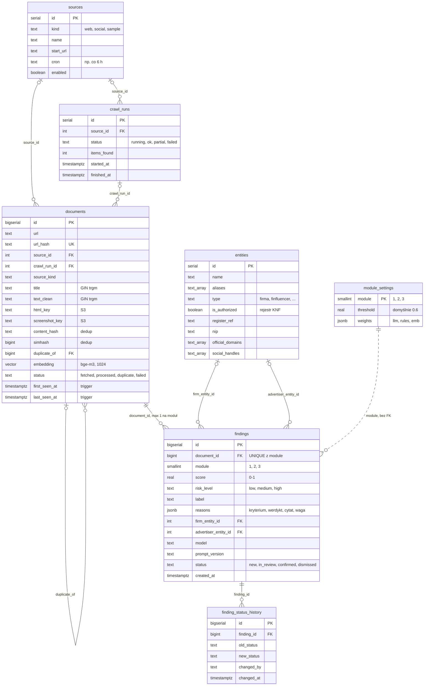

<!-- Slajd 1 -->
# InvestWatch
### Automatyczny monitoring treści inwestycyjnych w polskim internecie

**Zadanie UKNF · HackNation 2026 · 100% open-source i on-premise**

- **Problem:** szybki przyrost reklam inwestycyjnych w sieci i social mediach (finfluencerzy, brak lub ukrycie ostrzeżeń o ryzyku, nielegalne doradztwo poza rejestrem KNF).
- **Wyzwanie nadzoru:** ręczny przegląd setek stron i postów jest wolny, a materiały reklamowe szybko znikają.
- **Rozwiązanie:** system wykrywający naruszenia w 3 modułach (M1/M2/M3) z gotowym dowodem: **dosłownym cytatem, oceną kryteriów i screenshotem z S3**.

---

<!-- Slajd 2 -->
## Architektura systemu (100% on-premise)

> Źródło diagramu: `presentation/architecture.mmd` (osadzony jako wektorowy SVG w `InvestWatch.pdf`)

- **Stos:** Node 22 (TS strict: `collector`, `api`), Python 3.12 (`ai` FastAPI), React 19 + Vite (`web`), PostgreSQL 16 + `pgvector` + `pg_trgm`, Valkey 8, SeaweedFS S3, Ollama.
- **Uruchomienie jedną komendą:** `cp .env.example .env && docker compose up --build` (wszystkie obrazy z przypiętymi wersjami).

---

<!-- Slajd 3 -->
## Schemat bazy danych (PostgreSQL 16 + pgvector + pg_trgm)

> Źródło diagramu: `presentation/database.mmd` (osadzony jako wektorowy SVG w `InvestWatch.pdf`; źródło prawdy: `docs/contracts.md`, `infra/db/001–004`)

**Kluczowe decyzje:**
- Max 1 finding na dokument i moduł: `UNIQUE (document_id, module)` — `ai` wykonuje upsert.
- Każda flaga ma dowód: `reasons[]` = kryterium, werdykt, cytat, waga.
- Filtry dashboardu: indeks `(module, risk_level, status, created_at)`, wyszukiwarka `q`: `pg_trgm` (GIN) na `title` i `text_clean`.
- Deduplikacja i podobieństwo: `url_hash` UNIQUE, `content_hash`, `simhash`; `pgvector` z embeddingiem `bge-m3` (`vector(1024)`).
- Okresowa aktualizacja M1: trigger `documents_track_seen` ustawia `first_seen_at` / `last_seen_at`.
- `module_settings` (próg i wagi) łączy się z `findings.module` logicznie, bez FK.

---

<!-- Slajd 4 -->
## Moduł 1/3: `collector` i `api` — zbieranie danych i agregacja wyników

- **`collector` (Node 22 + Playwright + BullMQ):**
  - **Zakres źródeł (MVP):** aktywne adaptery `sample` (dane offline + syntetyki gold set), `web` (Chromium, discovery z głębokości 1, rotacja 23 User-Agentów i `PROXY_LIST`, limit 2/host, jitter), `youtube` (publiczny RSS kanałów) oraz `tiktok` (pojedyncze filmy przez oEmbed + fallback JSON, #51) + harmonogram `sources.cron`. Adaptery FB/IG pozostają poza obecnym MVP (gotowy interfejs adaptera; filtr w UI dynamicznie ukrywa nieaktywne typy z `GET /sources`).
  - **Ochrona przed SSRF (`collector/src/adapters/ssrf.ts`, #74):** `isBlockedUrl` (DNS + `net.BlockList`) i `context.route('**/*')` blokują żądania i przekierowania na loopback, sieci prywatne, link-local i usługi Compose.
  - **Odporność i zapis dowodów:** HTML + screenshot PNG w SeaweedFS S3, `upsert` po `url_hash`, triggery `first_seen_at` / `last_seen_at`, status `partial` przy błędzie analizy oraz jednorazowy retry po HTTP 502 (`AI_RETRY_DELAY_MS`, #90).
- **`api` (Fastify + Drizzle + Socket.io):**
  - **Agregator M1/M2/M3 (`GET /documents`, `GET /documents/:id`):** składa wyniki modułów w jeden rekord dokumentu (`modules` `"1"/"2"/"3"` + podsumowanie `overall`: `maxScore`, `riskLevel`, `flaggedModules`).
  - **Śledzenie widoczności reklam M1:** `first_seen_at`, `last_seen_at` oraz wyliczane `isActive` (karencja 1 h po późniejszym pełnym przebiegu `ok`).
  - REST API + Socket.io (`alert:new`, `finding:updated`, `crawl:status`), indeksy GIN `pg_trgm`, zapis progu (`PUT /settings/modules/:module`) wywołujący `POST /recompute-risk?module=` w `ai` (#84), presigned URL (15 min), eksport CSV/JSON i opcjonalny `ADMIN_TOKEN`.

---

<!-- Slajd 5 -->
## Moduł 2/3: `ai` — tokenizacja, embeddingi oraz M1/M2/M3

- **Preprocessing:** ekstrakcja tekstu (`trafilatura`) → deduplikacja dokładna (SHA-256) i przybliżona (`simhash` na 3-gramach słów, próg Hamminga `6`) → **tokenizacja i embeddingi** (tokenizacja leksykalno-fleksyjna z granicami słów dla aliasów KNF + wektory `bge-m3` `vector(1024)` w `pgvector`).
- **3 moduły analityczne (na `main`):**
  1. **M1 (Finfluencerzy):** wzmianka o firmie z rejestru KNF (86 podmiotów w `entities.csv`) spoza jej `official_domains` / `social_handles`; prompt `m1-v3` (wagi `0.7/0.2/0.1` na promocję, linki partnerskie i oznaczenia sponsorowane) + automatyczna encja reklamującego `advertiser_entity_id` (`resolve_advertiser`, #83).
  2. **M2 (Informacja o ryzyku):** ewolucja `m2-v1` (4 kryteria) → `m2-v3` (8 kryteriów wg MiFID II art. 44 / rozporządzenia 2017/565) → **`m2-v5` (16 kryteriów tekstowych** zmapowanych na reguły 1, 2, 3, 6, 9–12b, 14–18 załącznika UKNF + wymuszenie odpowiedzi dla wszystkich kryteriów przez `minItems`/`maxItems`; 5 reguł układu graficznego 4, 5, 7, 8, 13 wymaga HTML/screenshotu i jest poza zakresem tekstowym).
  3. **M3 (Shadow advisory):** nielicencjonowane doradztwo i zarządzanie portfelem wg **art. 76** ustawy o obrocie instrumentami finansowymi (**`m3-v5` + `m3-rules-v4`**, #95) z filtrowaniem klauzul disclaimerów (`strip_disclaimers()` po `ale/jednak/natomiast/lecz`, `;`, `–` — zastrzeżenie nie jest dowodem, ale porada obok niego zostaje wykryta).
- **Dlaczego `Bielik-11B-v2.3-Instruct` i `bge-m3` zamiast `Gemma` / `BERT`?**
  - **Bielik 11B (Apache-2.0):** natywny polski tokenizer i korpus → precyzyjna polska fleksja, terminologia UKNF i strukturalny JSON. Pomiar na GPU RTX 3060 12 GB: **3,4–5,8 s** (M1/M3), **9–10,5 s** (M2), **< 0,15 s** bez modułu.
  - **`bge-m3` (MIT):** okno 8192 tokenów (16× więcej niż klasyczny BERT) i wielojęzyczne wektory 1024-dim w tej samej Ollamie.

---

<!-- Slajd 6 -->
## Moduł 3/3: `web` — dashboard analityka UKNF

- **Widoki robocze (React 19 + Vite + Tailwind + Recharts, styl instytucjonalny `knf.gov.pl`):**
  - **Findingi:** tabela incydentów z filtrami (moduł, ryzyko, status, dynamiczne źródło z `GET /sources`, zakres dat w czasie lokalnym `Europe/Warsaw` #88, wyszukiwarka pełnotekstowa `q` z debounce 300 ms) oraz paginacją.
  - **Szczegóły findingu:** pełna treść po czyszczeniu, lista `reasons[]` z etykietami per moduł (M1/M3: „wykryto” / „nie wykryto”; M2: checklista), **dosłownym cytatem**, podglądem PNG z S3 i historią statusów.
  - **Trendy i raportowanie:** kafelki podsumowania (`/stats/summary`), wykres incydentów w czasie grupowany po dniu lokalnym (`bucket=hour`), eksport CSV/JSON dla polskiego Excela (`;`, przecinek dziesiętny, BOM UTF-8, neutralizacja formula injection `= + - @`).
  - **Kalibracja, alerty i źródła:** toasty `alert:new` przez Socket.io, licznik **„Oznaczone flagą”** (`tp + fp`), zapis progu i wag (opcjonalny `VITE_ADMIN_TOKEN`, #71) z automatycznym odświeżeniem list i kafelków (#84) oraz przycisk **„Uruchom crawl”**.
- **Lekki i bezpieczny obraz produkcyjny (`vitest`: 100 testów):** code-splitting (`React.lazy`, główny chunk 346 kB) serwowany przez **`nginx:1.30.7-alpine` + `apk upgrade libxml2`** (**Trivy: 0 CRITICAL / 0 HIGH**), bez `env_file`.

---

<!-- Slajd 7 -->
## Kalibracja, wiarygodność i odporność na prompt injection

- **Hybrydowy scoring:**
  `score = w_llm * llm + w_rules * rules + w_emb * emb` (domyślnie `0.60 / 0.25 / 0.15`, edytowalne w `module_settings`).
- **Zasada „bez cytatu nie ma flagi” i walidacja wielozdaniowa:**
  - `CriterionResult.quote` i komplet kryteriów (`minItems`/`maxItems`) wymagane w schemacie JSON (Pydantic `format`, `temperature: 0`).
  - `quotes.py` weryfikuje dopasowanie cytatu do dokumentu (`rapidfuzz.partial_ratio >= 90`; dla cytatu wielozdaniowego każde zdanie osobno). Przy awarii LLM dokument otrzymuje `failed` — zero zmyślonych wyników.
- **Odporność na prompt injection (`ai/tests/test_prompt_injection.py`):**
  - Treść strony izolowana w `<document>...</document>` (`neutralize_delimiters` w `llm.py`): **12 testów offline + 3/3 testy live na Bieliku 11B** (wyniki z atakiem identyczne z bazowymi: M1 `0.941`, M2 `1.000`, M3 `0.956`, zero cytatów z payloadu ataku).
- **Progi i panel kalibracji (`GET /eval` + `gold.csv` + `rubric.md`):**
  - `high >= max(0.8, próg)` (alert Socket.io), `medium >= próg`, `low < próg` — spójna reguła `#84` w `ai` (`/recompute-risk` po zapisie progu); suwak na żywo wylicza `precision`, `recall`, `TP`, `FP`, `FN`, `TN`, `total` i `missingFindings` (#112) na **120-wierszowym `gold.csv` (40/40/40 po kluczu URL)** z narzędziami `load_gold.py`, `analyze_gold.py`, `calibration_table.py` i `METHODOLOGY.md`.

---

<!-- Slajd 8 -->
## Bezpieczeństwo i czystość licencyjna

- **Izolacja sieci, portów i kontenerów (#72):** wszystkie usługi w sieci bridge Docker Compose; porty pomocnicze (`postgres`, `valkey`, `seaweedfs`, `ollama`, `ai`) zbindowane wyłącznie do **`127.0.0.1`**, na zewnątrz tylko `web` (`5173`) i `api` (`3000`); `web` bez `env_file` (sekrety niedostępne w kontenerze); kontenery `api` (`USER node`), `collector` (`USER pwuser`) i `ai` (`USER app`, `uid=10001`) non-root; przypięte wersje obrazów.
- **Sekrety, uwierzytelnianie i SSRF:** sekrety wyłącznie w `.env` (`.gitignore`), walidacja `zod` przy starcie (`INTERNAL_TOKEN` >= 16 znaków); `/internal/*` chronione `X-Internal-Token` (`timingSafeEqual` na SHA-256), uwierzytelniany S3 SeaweedFS (`-s3.config` + SigV4), opcjonalny `ADMIN_TOKEN` na zapisach REST (#71) i `AI_REQUIRE_TOKEN` (`hmac.compare_digest`), blokada SSRF w `collector` (#74), maskowanie `redact` w `pino`, rate-limit `300/min` (`10/min` `/export`).
- **100% lokalne AI i czyste licencje (`docs/SECURITY.md`, `docs/DEPENDENCIES.md`):** Valkey (BSD-3), SeaweedFS (Apache-2.0), `asyncpg` (Apache-2.0), Bielik (Apache-2.0), `bge-m3` (MIT).
- **Wyniki audytów (22.11, Trivy 0.76.2):** `npm audit` ×3 i `pip-audit` (`47` runtime / `50` dev + OSV `55` paczek) = **0 podatności**; obrazy w Trivy: `web` **`0C / 0H`**, `valkey:8.1.12-alpine` **`0C / 0H`**, `seaweedfs:4.52` **`0C / 1H`**, `ai` (`python:3.12.16-slim-trixie`) **`0C / 51H`** (`--ignore-unfixed` → `0`).

---

<!-- Slajd 9 -->
## Standaryzowany proces pracy z AI (20% oceny — `docs/AI_PROCESS.md`)

- **Kontrakt w `CLAUDE.md` + 5 skilli (`.claude/skills/`):** obowiązek *plan-first* (najpierw plan i akceptacja człowieka, potem kod), zakaz `console.log`/`print`, skille `scraper-adapter`, `risk-classifier`, `data-contract`, `dependency-guard`, `demo-check`.
- **Ochrona w Gicie (`.githooks/pre-commit`):** twardy podział katalogów na 6 branchy `team/*`, blokada commitów na `main` oraz automatyczna blokada sekretów w diffie.
- **Przykłady z `docs/AI_PROCESS.md`, gdzie weryfikacja człowiek + AI wyłapała błędy:**
  - `ai-core`: `dependency-guard` odrzucił `psycopg` (LGPL-3.0) → `asyncpg` (Apache-2.0); testy na żywym Bieliku wykryły kopiowanie cytatu i sklejanie zdań → `m2-v2`/`m3-v2` oraz walidacja per zdanie w `quotes.py`.
  - `ai-data` + `api`: testy na `pgvector` podniosły próg `simhash` `3 → 6`; w `api` złapano błąd `date_trunc`, kolizję `"id"` w `/sources` oraz brak kwalifikacji tabeli w `seen.ts`.
  - `web` + `lead-collector` + `infra`: test na żywym API naprawił zapis progu kalibracji (`weights`), skan Trivy wykrył i załatał `libxml2` w `web` (`0C/0H`), a w `collector`/`infra` naprawiono `ioredis`, `pull-models.sh` i healthcheck `web`.

---

<!-- Slajd 10 -->
## Demo na żywo — kluczowy przepływ

1. **Start stosu:** `docker compose up --build` → czyste środowisko z gotowym buckietem S3, bazą `pgvector` i modelami w Ollamie.
2. **Wyzwolenie crawla:** ekran **Źródła** → **„Uruchom crawl”** → status `crawl:status` na żywo.
3. **Alert wysokiego ryzyka:** toast **`alert:new`** w przeglądarce bez odświeżania strony.
4. **Analiza dowodów:** wejście w szczegóły findingu (oraz agregator `/documents`) → cytaty per kryterium + screenshot z SeaweedFS S3 + ocena modułów M1/M2/M3.
5. **Kalibracja i raport:** suwak progu zmienia `precision` / `recall` / `FP` / `FN` i licznik „Oznaczone flagą”, zmiana statusu na `confirmed` i eksport CSV.

*(Pełny scenariusz z podziałem na sekundy: `presentation/DEMO_SCRIPT.md`.)*

---

<!-- Slajd 11 -->
## Dalszy rozwój i skalowanie

- **Analiza 5 reguł układu graficznego M2 (reguły UKNF 4, 5, 7, 8, 13):** weryfikacja rozmiaru czcionki, kontrastu, dostępu jednym kliknięciem, responsywności oraz dominacji wyników historycznych na wyrenderowanym DOM i screenshotach S3 (VLM / Playwright CSS metrics).
- **Pełne adaptery Facebook / Instagram i rozbudowa rejestru KNF (`entities.csv`):** wdrożenie kolektorów FB/IG oraz listingu profili TikTok (interfejs `Adapter` gotowy w `collector/`) oraz uzupełnienie `official_domains` i `social_handles` dla wszystkich podmiotów KNF.
- **Analiza wideo (OCR / ASR) i pełny hardening HTTP/TLS:** lokalna transkrypcja rolek (YouTube Shorts, TikTok, Reels), odczyt drobnego druku z kreacji oraz wystawienie wyłącznie portów `web` i `api` za reverse proxy z TLS (`AI_REQUIRE_TOKEN=true` działa już domyślnie w `.env.example`, #70/#105).
- **Ciągłe strojenie jakości i skalowanie GPU:** rozbudowa zbioru `gold.csv` wg `ai/eval/rubric.md`, okresowa re-ewaluacja przez `POST /reanalyze` oraz skalowanie `OLLAMA_NUM_PARALLEL > 1` na wielu GPU.
