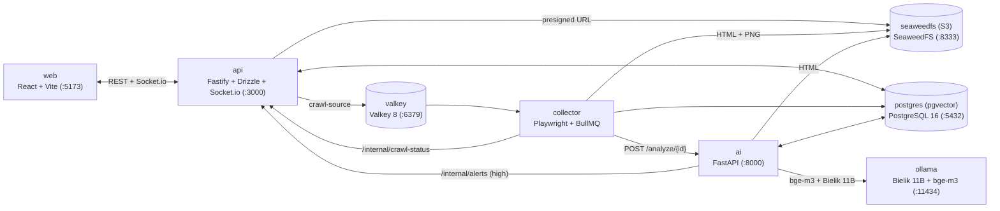

# InvestWatch
### Automatyczny monitoring treści inwestycyjnych w polskim internecie

Zadanie UKNF · HackNation 2026 · 100% open-source i on-premise

---

## 1. Problem i kontekst UKNF

- Dynamiczny wzrost liczby reklam inwestycyjnych w internecie i social mediach (finfluencerzy, agresywne obietnice zysku, nieautoryzowane podmioty).
- Kluczowe wyzwania nadzoru:
  - Wyłapywanie promocji podmiotów nadzorowanych prowadzonej przez osoby trzecie bez wyraźnego oznaczenia.
  - Weryfikacja rzetelności informacji o ryzyku w materiałach samych firm inwestycyjnych.
  - Identyfikacja nielegalnego doradztwa inwestycyjnego („shadow advisory”) poza rejestrem KNF.
- **Cel:** dać analitykowi gotowy dowód z cytatem i screenshotem w kilka sekund zamiast ręcznego przeglądania setek stron.

---

## 2. Architektura systemu (100% on-premise)

---

## 3. Główne komponenty systemu

- **`collector` (Node 22 + Playwright + BullMQ):** harmonogram i kolejka `crawl-source` w Valkey, rotacja User-Agent i proxy, zapis surowego HTML i screenshota do SeaweedFS S3, wywołanie `POST /analyze/{document_id}`.
- **`api` (Node 22 + Fastify + Drizzle + Socket.io):** REST API z filtrami i eksportem CSV/JSON, presigned URL-e do screenshotów, audyt zmian statusu (`finding_status_history`), alerty real-time `alert:new`.
- **`ai` (Python 3.12 + FastAPI + Ollama):** czyszczenie HTML (`trafilatura`), deduplikacja (SHA-256 + simhash), embeddingi `bge-m3` (1024 wymiary), analiza M1/M2/M3 przez `SpeakLeash/bielik-11b-v2.3-instruct:Q4_K_M`.
- **`web` (React + Vite + Recharts):** lista findingów, ekran szczegółów z cytatami i screenshotem, wykres trendów, toasty `alert:new`, panel kalibracji.

---

## 4. Trzy moduły analityczne (M1 / M2 / M3)

| Moduł | Zakres wykrywania | Mechanizm i wynik |
|---|---|---|
| **M1 — Finfluencerzy** | Wzmianki o firmie z rejestru KNF publikowane spoza jej `official_domains` / `social_handles` | Dopasowanie nazw/aliasów (86 podmiotów KNF), wykrywanie krótkich skrótów z anchorem promocyjnym |
| **M2 — Informacja o ryzyku** | Materiały na oficjalnych domenach firm inwestycyjnych | Checklista 4 kryteriów: `risk_warning_present`, `risk_prominence`, `profit_risk_balance`, `no_guaranteed_returns` |
| **M3 — Shadow advisory** | Podmioty spoza rejestru KNF oferujące doradztwo lub zarządzanie portfelem | Hybryda: słownik reguł + podobieństwo embeddingów `bge-m3` + ocena LLM |

---

## 5. Kalibracja i wiarygodność wyników

- **Scoring hybrydowy:** `score = w_llm * llm + w_rules * rules + w_emb * emb` (domyślnie `0.60 / 0.25 / 0.15`, konfigurowalne w bazie `module_settings`).
- **Zasada „bez cytatu nie ma flagi”:** każde kryterium w `reasons[]` wymaga dosłownego cytatu z tekstu (<= 300 znaków); brak dowodu = `unclear`, brak wymyślonych wyników przy awarii LLM.
- **Poziomy ryzyka:** `high` >= 0.8 (natychmiastowy toast Socket.io), `medium` >= próg modułu, `low` < próg.
- **Kalibracja na żywo (`GET /eval` + `gold.csv`):** przesuwanie suwaka progu w dashboardzie na bieżąco przelicza `precision`, `recall`, `TP`, `FP`, `FN`, `TN` oraz liczbę flagowanych dokumentów.

---

## 6. Bezpieczeństwo i czystość licencyjna

- **Zero zewnętrznych API LLM:** cała inferencja i embeddingi działają lokalnie w Ollama.
- **Ochrona sekretów:** wyłącznie w lokalnym `.env` (`.gitignore`), wstrzykiwane przez `env_file`; endpointy `/internal/*` chronione nagłówkiem `X-Internal-Token` (`timingSafeEqual` na skrótach SHA-256), maskowanie sekretów (`redact`) w `pino`.
- **Odporność na prompt injection:** w `ai/prompts/m2-risk-info/system.md` treść dokumentu jest odseparowana w `<document>...</document>` i oznaczona jako nieufne dane.
- **Czyste licencje dla UKNF:** Valkey (BSD-3 zamiast Redisa RSAL/SSPL), SeaweedFS (Apache-2.0 zamiast MinIO AGPL), `asyncpg` (Apache-2.0 zamiast `psycopg` LGPL-3.0).
- **Przypięte wersje i audyt:** brak tagów `latest`, `exclude-newer` w `uv`, skany `pip-audit` (`ai/SECURITY.md` — 0 CVE) i `npm audit` (`web/SECURITY.md` — 0 podatności).

---

## 7. Standaryzowany proces pracy z AI

- **`CLAUDE.md` jako wspólny kontrakt zespołu:** zasady *plan-first* (najpierw plan i akceptacja człowieka, potem kod), zakaz `console.log`/`print`, wymóg `strict` w TS i typowania Pydantic v2 w Pythonie.
- **5 dedykowanych skilli w `.claude/skills/`:** `scraper-adapter`, `risk-classifier`, `data-contract`, `dependency-guard`, `demo-check`.
- **Ochrona repozytorium (`.githooks/pre-commit`):** twarde przypisanie katalogów do 6 branchy `team/*`, blokada commitów na `main` oraz automatyczne blokowanie sekretów w diffie.
- **Pełna ścieżka audytu (`docs/ai-log/*.md`):** każdy członek zespołu loguje zlecenie, użyty skill oraz poprawki zweryfikowane przez człowieka.

---

## 8. Proces AI w praktyce — przykłady z `docs/ai-log/`

- **`ai-core` (`dependency-guard`):** wykryto licencję LGPL-3.0 dla `psycopg` przed instalacją → zmieniono na `asyncpg` (Apache-2.0); testy złapały błąd walidacji `Literal[1,2,3]` jako query param w FastAPI.
- **`ai-data` (`risk-classifier`):** testy integracyjne na `pgvector` pokazały, że `HAMMING_THRESHOLD=3` przepuszcza near-duplikaty (dystans 5–6) → próg podniesiono do `6`.
- **`api` (`data-contract`):** doprecyzowano w kontrakcie konwersję `simhash` (unsigned 64-bit w Pythonie vs signed `bigint` w Postgresie) i `UNIQUE (document_id, module)` pod `/reanalyze`.
- **`infra` (`dependency-guard`):** wychwycono brakujący namespace modelu Bielik w `ollama-init` oraz ciche maskowanie błędu JSON przez `curl | tail`.

---

## 9. Scenariusz demo na żywo (3–5 min)

1. `docker compose up` → czysty dashboard, źródła gotowe.
2. Klik **„Uruchom crawl”** → dokumenty trafiają przez `collector` → S3 → `ai` → `api`.
3. **Toast na żywo (`alert:new`):** reklama wysokiego ryzyka (M2) → podgląd cytatów i screenshota z S3.
4. **Moduł M1:** finfluencer promujący dom maklerski spoza oficjalnych domen → firma + reklamujący + URL.
5. **Moduł M3:** podmiot spoza rejestru KNF oferujący indywidualne doradztwo.
6. **Panel kalibracji:** zmiana progu suwakiem → natychmiastowa zmiana `FP` vs `FN`.
7. Zmiana statusu na `confirmed` + historia zmian + eksport raportu CSV + wykres trendu.

---

## 10. Dalszy rozwój po hackathonie

- **Wzbogacenie rejestru podmiotów:** pełne uzupełnienie `official_domains` i `social_handles` dla podmiotów KNF w `entities.csv` (redukcja fałszywych alertów M1).
- **Analiza multimediów (OCR / ASR):** automatyczna transkrypcja rolek wideo (TikTok, YouTube Shorts, Instagram Reels) i ekstrakcja drobnego druku z grafik reklamowych.
- **Integracja z infrastrukturą UKNF:** podpięcie firmowego repozytorium obrazów, alertów do systemów analitycznych oraz automatycznej rotacji tokenów.
- **Ciągłe strojenie:** rozbudowa zbioru `gold.csv` o nowe kampanie i okresowa ewaluacja wag oraz promptów.
